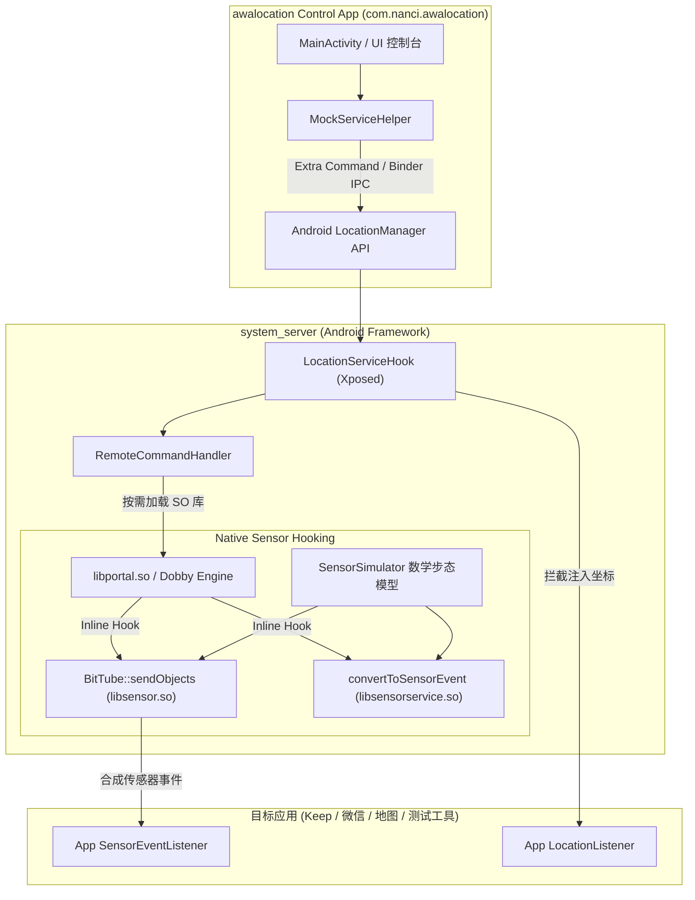

<div align="center">

# awalocation 2.0

**下一代 Android 原生级高精度虚拟定位与高拟真步态传感器模拟控制台**

[-3DDC84?style=flat-square&logo=android&logoColor=white)](#)
[](#)
[](#)
[](#)
[](LICENSE)

<p align="center">
  <a href="#-核心特性">核心特性</a> •
  <a href="#-技术架构">技术架构</a> •
  <a href="#-运行环境要求">环境要求</a> •
  <a href="#-快速上手">快速上手</a> •
  <a href="#-功能详解">功能详解</a> •
  <a href="#-编译构建">编译构建</a> •
  <a href="#-免责声明">免责声明</a>
</p>

</div>

---

## 📖 项目简介

**awalocation** 是一款面向移动开发者、地理信息系统（GIS）测试人员与传感器算法研究团队的高级系统级调试工具。

本项目深度结合 **Xposed/LSPosed 运行时注入** 与 **Native C++ 内存符号 Hook（Dobby 引擎）** 技术，从 Android `system_server` 核心服务层（`LocationManagerService`、`SensorService`、`BitTube`）到底层传感器数据流实现深度拦截与精准模拟。不仅支持经纬度、海拔、精准速度与航向角模拟，更完整移植实现了工业级的多模步态物理建模算法，能向系统实时合成高拟真、具备自然生理抖动的步频与步数事件。

---

## ✨ 核心特性

### 1. 全域高精度位置模拟
- **系统核心底层注入**：在 `system_server` 进程级拦截 `LocationManagerService` 与 `FusedLocationProvider`，对系统内所有通过标准 API 请求位置的应用全局生效。
- **动态物理航向与速度计算**：支持高拟真移动轨迹生成，自动计算经纬度位移向量，动态刷新 `bearing`（方位角）与物理平滑移动。
- **自定义环境参数**：支持自定义精确海拔（Altitude）、定位精度误差范围（Accuracy）、随机漂移幅度等真实环境指标。

### 2. 原生级步态与步频仿真（Gait Simulation）
- **Native BitTube & HAL 劫持**：底层移植自经过验证的 Native Sensor Hook 架构，对系统底层 `BitTube::sendObjects` 与 `convertToSensorEvent` 挂钩，直接向系统数据管道注入合成事件。
- **TYPE_STEP_COUNTER & TYPE_STEP_DETECTOR 协同伪造**：
  - **步数递增（Step Counter）**：基于真实传感器读数作为基线实现严格单调递增，不丢步、不倒退。
  - **步检测（Step Detector）**：按计算周期产生标准冲击事件脉冲。
- **生理自然抖动（Human Gait Jitter）**：内置 ±8% ~ ±10% 的人类自然步频节律微扰动模型，杜绝死板匀速步频检测特征。
- **自适应配速推算**：支持手动指定精确步频（步/分钟），或按当前移动速度通过步幅比例（平均步长 0.762m）智能实时换算。

### 3. GNSS / 卫星信号模拟
- **虚拟天线雷达图**：内置多星座卫星雷达视场角实时渲染，直观展示当前锁定的卫星仰角、方位角与信噪比（SNR）。
- **多星座支持**：可自定义模拟 GPS (USA)、GLONASS (Russia)、Galileo (EU)、北斗 BDS (China) 卫星可见列表与伪距信噪比波动。
- **AGPS / NMEA 数据模拟**：模拟真实硬件 GNSS 芯片吐出的 NMEA 原始语句与辅助定位指令。

### 4. 极致安全与稳定性保障
- **开机第二屏防护（Anti-Bootloop）**：采用严格的 **按需懒加载（Lazy Load）** 机制。模块在手机开机阶段绝不触发 Native 符号查找或 SensorManager 请求，彻底规避 `system_server` 早期死锁与看门狗重启。
- **系统核心进程隔离**：自动防御并跳过 `com.android.systemui`、系统桌面、WebView 等核心渲染进程，防止误注入引起掉帧或 UI 崩溃。
- **SELinux 与现代 Android 适配**：全面兼容 Android 9.0 ~ Android 17 (API 28 ~ 36)，包括澎湃 OS (HyperOS)、ColorOS、OriginOS 等定制 ROM。

### 5. 交互式调试辅助
- **悬浮移动摇杆（Floating Rocker）**：支持在任意应用上方悬浮半透明虚拟摇杆，步进平滑移动，支持自定义摇杆移动步长与瞬时速度。
- **路线规划与循环回放**：支持地图多点折线规划、历史位置/路线收藏、循环路径模拟及逆地理编码信息解析。

---

## 🛠️ 技术架构



---

## 📱 运行环境要求

| 项目 | 要求 | 说明 |
| :--- | :--- | :--- |
| **Android 版本** | Android 9.0 (API 28) ~ Android 17 (API 36) | 完美支持 HyperOS 1/2/3/4、原生 Android 等 |
| **设备架构** | `arm64-v8a` (推荐), `x86_64` | 32位老旧架构已不作推荐 |
| **Root 方案** | Magisk / KernelSU / APatch | 需要 Root 权限用于管理 `/data/local/awalocation-lib` |
| **Hook 框架** | LSPosed / LSPosed_mod / EdXposed | 必须在 LSPosed 中勾选本模块 |

> [!IMPORTANT]
> **LSPosed 模块作用域勾选建议**：
> 1. **系统框架（System Framework / `android`）**：必须勾选（提供全局定位与底层服务拦截）。
> 2. **目标应用**：勾选需要接受位置或步频调试的目标 App。
> 3. **勿勾选**：`系统界面 (SystemUI)` 等系统渲染进程（即使勾选模块内部也会安全跳过）。

---

## 🚀 快速上手

### 1. 安装与激活
1. 前往本仓库 [Releases](../../releases) 页面下载对应架构的 `awalocation-v2.0.0-arm64.apk`。
2. 安装 APK，打开 **LSPosed** 管理器，在模块列表中找到 **awalocation**。
3. 启用模块，并在作用域中勾选 **系统框架** 以及您的测试应用，重启设备生效。

### 2. 启动位置模拟
1. 打开 **awalocation** 应用，授予位置权限与悬浮窗权限（如需摇杆）。
2. 在地图上轻触选择目标位置，或在顶部搜索框输入地址 / 经纬度。
3. 点击右下角 **启动模拟** 悬浮按钮，状态栏出现定位通知即表示模拟已就绪。

### 3. 配置步频与摇杆
1. 侧滑打开导航抽屉，进入 **设置**：
   - **步频模拟开关**：开启
   - **步频设定（SPM）**：设为 `0` 则根据移动速度自适应推算（如跑步速度自动对应高步频），设为 `120~180` 则固定在设定区间并附带真实自然微扰。
   - **移动速度**：支持以 **公里/小时 (km/h)** 为基准单位设定。
2. 返回主界面展开右下角菜单开启 **移动摇杆**，即可在浮窗中直接推拉控制虚拟人员行走。

---

## 📦 编译构建

本项目基于标准的 Gradle + Android Gradle Plugin 8.9+ 构建：

```bash
# 1. 克隆代码仓库
git clone https://github.com/nanci0406/awalocation.git
cd awalocation

# 2. 赋予脚本执行权限
chmod +x gradlew

# 3. 编译全架构 Release APK
./gradlew :app:assembleRelease --parallel
```

编译产物将生成于：
- `app/build/outputs/apk/arm64/release/awalocation-v2.0.0-*-arm64.apk`
- `app/build/outputs/apk/app/release/awalocation-v2.0.0-*-all.apk`

---

## ⚠️ 免责声明 (Disclaimer)

> [!CAUTION]
> **在使用本项目（awalocation）之前，请务必仔细阅读本免责声明：**

1. **研发与学习目的**：
   本项目系供移动应用开发者、地理位置信息研究人员、学生及安全技术爱好者在个人测试机、开发板或受控沙盒环境中进行 **应用功能调试、网络位置容错测试及步态算法验证** 之用。
2. **遵守法律法规**：
   使用者应当严格遵守所在国家和地区的相关法律法规。严禁将本项目及其衍生软件用于包括但不限于：
   - 虚假打卡、作弊考核、商业欺诈；
   - 侵入、干扰、破坏计算机信息系统与合法网络服务；
   - 规避平台安全策略或侵犯第三方企业与个人的合法权益。
3. **责任自负原则**：
   本软件按“原样”（AS-IS）提供，开发者不提供任何明示或暗示的担保（包括但不限于适销性、特定用途适用性及无侵权保证）。任何企业、组织或个人因使用、修改、分发本软件而直接或间接引起的任何行政处罚、民事纠纷、数据丢失、硬件损坏或经济损失，**均由行为人自身全权承担全部法律责任，原作者与贡献团队概不承担任何连带责任**。
4. **开源许可协议**：
   本项目基于 **Apache License 2.0** 协议开源。在遵守本协议的前提下，您可以自由分发、修改代码，但必须保留原始版权信息与本免责声明。

---

## 🤝 鸣谢与参考

- [Portal](https://github.com/fuqiuluo/Portal) by @fuqiuluo
- [kail_location](https://github.com/noellegazelle6/kail_location) by @noellegazelle6
- [Dobby](https://github.com/jmpews/Dobby) by @jmpews
- [LSPosed Framework](https://github.com/LSPosed/LSPosed)

---

<div align="center">
  <b>awalocation Project</b> • Maintained with ❤️ for advanced Android engineering
</div>
