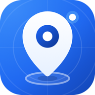

<div align="center">



# awalocation

一个基于 LSPosed + Dobby 的 Android 虚拟定位、路线模拟与步频模拟工具。

[-3DDC84?style=flat-square&logo=android&logoColor=white)](#环境要求)
[](#环境要求)
[](#环境要求)
[](LICENSE)

</div>

---

## 说明（先看这两条）

1. **关于高德地图 Key**：Release 里打出来的成品包用的是我个人的高德 Key，每天免费调用额度有限，人一多就可能触发限流（地图空白、搜索无结果）。**建议大家直接 Fork 本仓库，用自己的高德 Key 和签名通过 GitHub Actions 编译自己的包**，下面有完整的申请和配置步骤。
2. **关于 AI 辅助开发**：本项目在重构 UI、排查问题和编写部分代码时**大量使用了 AI 辅助开发**，加上我手头测试机型和系统版本有限，难免会有没测到的边角 Bug 或某些国产 ROM 的兼容问题。如果碰到闪退、定位不生效、步频异常等情况，欢迎直接提 Issue（带上 Android 版本、ROM 和相关 Logcat），有能力的朋友也欢迎直接提 PR 修。

---

## 主要功能

- **系统级定位模拟**：在 `system_server` 里 Hook `LocationManagerService`、`LocationProviderManager`、`FusedLocationProvider`、`MiuiBlurLocationProvider` 以及基站 / Wi-Fi 定位接口。
- **地图选点与搜索**：接入高德 3D 地图，支持点选位置、POI 联想搜索、直接输入经纬度跳转（如 `39.9087, 116.3975`）和逆地理编码。
- **路线绘制与回放**：地图十字准星逐点画轨迹，支持撤回、收藏和循环模拟，用 `GeographicLib-Java` 按 WGS84 测地线算航向和步进位移。
- **悬浮摇杆**：在「地图」页右侧快捷按钮可随时开/关悬浮摇杆（在「位置」或「路线」页启动模拟时也会自动弹出），支持折叠收起和手动拖向移动。
- **步频与步数模拟**：底层移植了 `kail_location` 的 Native C++ Hook（用 Dobby 挂钩 `BitTube::sendObjects` 和 `convertToSensorEvent`），同时伪造 `TYPE_STEP_COUNTER` 与 `TYPE_STEP_DETECTOR`，带自然抖动；步频（SPM）设为 `0` 时按移速自动算，也可以手动填固定区间。
- **GNSS 卫星与 NMEA**：内置卫星雷达图，可模拟 GPS / GLONASS / Galileo / 北斗卫星信号和 NMEA 语句。
- **界面与外观**：底部 5 个 Tab（地图 / 位置 / 路线 / 卫星 / 设置），蓝白配色 Material 3 风格，Android 12+ 支持动态取色（Material You）和浅色 / 深色 / 跟随系统切换。
- **防卡开机与进程隔离**：Native 库按需懒加载，开机阶段不触发 SensorManager 初始化；自动跳过 `com.android.systemui` 等系统界面进程。

---

## 工程结构

| 模块 | 说明 |
| :--- | :--- |
| [`:app`](app) | 前端控制台（地图、位置、路线、卫星、设置、悬浮摇杆） |
| [`:xposed`](xposed) | LSPosed Hook、Binder/LocationManager 指令通信、Native Dobby 传感器 Hook（`libawalocation.so`） |
| [`:nmea`](nmea) | NMEA 0183 语句生成与解析 |
| [`:system-api`](system-api) | Android 隐藏 API 编译期存根 |

---

## 环境要求

- **系统**：Android 8.0 (API 26) ~ Android 17 (API 36)
- **架构**：`arm64-v8a`
- **Root**：Magisk / KernelSU / APatch（用于管理底层 Native 库目录及可选的 SELinux 宽容切换）
- **框架**：LSPosed / LSPosed_mod

**LSPosed 作用域勾选：**
- 必须勾选：**系统框架（System Framework / `android`）**
- 按需勾选：需要接受模拟位置或步频的目标 App
- 不要勾选：`系统界面（SystemUI）`、桌面等系统渲染进程（模块内部也会跳过）

---

## 简单上手

1. 安装 APK，在 LSPosed 里启用 `awalocation`，勾好作用域后**重启手机**。
2. 打开 App 授予定位权限（用摇杆需要悬浮窗权限）。
3. **单点模拟**：在「地图」页点选或搜索位置，底部卡片点「模拟此处」即可开始，也能收藏到「位置」页统一管理。
4. **路线模拟**：切到「路线」页新建路线，拖动地图用中心准星逐个打点保存，选中路线后点「启动模拟」。
5. **参数调整**：切到「设置」页可以改移动/摇杆速度（km/h）、海拔、精度、上报间隔、最少卫星数、步频（SPM）、SELinux 宽容模式，以及动态取色和深浅色主题。
6. **悬浮摇杆**：在「地图」页右侧快捷按钮可手动开关，启动模拟时也会自动拉起。

---

## 自己申请高德 Key 并编译（推荐）

因为高德 Android SDK 会同时校验**包名**和 **APK 签名 SHA1**，所以想用自己的 Key，需要准备一个固定的签名证书（`.jks`），再把对应的 SHA1 填到高德控制台里。

### 第一步：准备签名文件并获取 SHA1

如果你还没有签名证书，先用 JDK 自带的 `keytool` 生成一个（密码和别名自己记住）：

```bash
keytool -genkeypair -v \
  -storetype PKCS12 \
  -keystore awalocation.jks \
  -alias awalocation \
  -keyalg RSA -keysize 2048 -validity 10000
```

查看这个证书的 SHA1（如果是本地 Debug 调试，把路径换成 `~/.android/debug.keystore`，默认密码 `android`）：

```bash
keytool -list -v -keystore awalocation.jks
```

在输出的 `证书指纹` 里找到 **`SHA1`** 那一行复制下来，格式类似 `AA:BB:CC:...`（**保留冒号**，不要删）。

### 第二步：在高德开放平台申请 Android Key

1. 打开 [高德开放平台](https://lbs.amap.com/) 注册登录并完成开发者认证，进入控制台。
2. 左侧菜单进入 **应用管理 -> 我的应用**，点右上角 **创建新应用**（名字和类型随便选）。
3. 在刚建好的应用右侧点 **添加 Key**：
   - **Key 名称**：随便填，比如 `awalocation`
   - **服务平台**：选 **Android 平台**（别选错成 Web 服务）
   - **发布版安全码 SHA1**：填上面 `awalocation.jks` 的 SHA1
   - **调试版安全码 SHA1**：本地真机 Debug 的话填 `debug.keystore` 的 SHA1，不本地调试的话直接填和发布版一样的也行
   - **PackageName**：填 `com.nanci.awalocation`（如果你自己改了 `applicationId` 就填改完的包名）
4. 点提交即可拿到一串 Android Key。刚修改 SHA1 或包名后通常要等 5～10 分钟生效。

### 第三步：编译 APK（二选一）

#### 方式 A：Fork 仓库用 GitHub Actions 编译（不用配本地环境）

1. 先把你的 `awalocation.jks` 转成 Base64 字符串：
   - macOS：`base64 -i awalocation.jks | pbcopy`（直接进剪贴板）
   - Linux：`base64 -w 0 awalocation.jks`
   - Windows PowerShell：`[Convert]::ToBase64String([IO.File]::ReadAllBytes("awalocation.jks")) | Set-Clipboard`
2. Fork 本仓库后，打开你仓库的 `Settings -> Secrets and variables -> Actions`，新建下面 5 个 Repository secrets：

| Secret 名称 | 填什么 |
| :--- | :--- |
| `AMAP_API_KEY` | 刚才在高德控制台拿到的 Android Key |
| `SIGN_KEYSTORE_BASE64` | 上一步转出来的 `awalocation.jks` Base64 内容 |
| `SIGN_KEYSTORE_PASSWORD` | 生成证书时设的 keystore 密码 |
| `SIGN_ALIAS` | 生成证书时设的 alias（上面示例里是 `awalocation`） |
| `SIGN_KEY_PASSWORD` | key 密码（一般和 keystore 密码相同） |

3. 进入你仓库的 **Actions** 页，选择 `Build Apks`，点 **Run workflow**，跑完直接在 Artifacts 里下载 `awalocation-v2.0.0-*-arm64.apk` 即可。

> 如果没配 `SIGN_KEYSTORE_BASE64`，工作流会每次临时生成一把随机签名，SHA1 每次都会变，高德 Key 会直接鉴权失败（地图白屏），所以一定要配固定签名。

#### 方式 B：本地编译

本地需要 JDK 17 / 21、Android SDK（API 36）、NDK `26.1.10909125` 和 CMake `3.22.1`（AGP `9.5.0`，Kotlin `2.2.21`）。

```bash
git clone https://github.com/nanci0406/awalocation.git
cd awalocation

# 在项目根目录的 local.properties 里追加一行（或 export AMAP_API_KEY="你的Key"）
# AMAP_API_KEY=你的高德AndroidKey

chmod +x gradlew
./gradlew :app:assembleArm64Debug
# 正式签名包：配好 KEYSTORE_PATH / KEYSTORE_PASSWORD / KEY_ALIAS / KEY_PASSWORD 环境变量后执行
# ./gradlew :app:assembleRelease --parallel
```

- Debug 产物：`app/build/outputs/apk/arm64/debug/awalocation-v2.0.0-*-arm64.apk`
- Release 产物：`app/build/outputs/apk/arm64/release/awalocation-v2.0.0-*-arm64.apk`
- 排查常见报错：高德返回 `INVALID_USER_SCODE` 或错误码 `7` 时，99% 是当前 APK 的签名 SHA1 或包名和高德控制台填的不一致。

> Bugly 异常上报默认关闭（`BUGLY_APPID` 默认为空，不配置不会初始化）；如果你有自己的 Bugly，也可以在 `local.properties` 或环境变量里填 `BUGLY_APPID`。

---

## 致谢与上游项目

本项目基于多个开源项目二次开发与整合，感谢各位原作者的付出，完整归属与版权信息见 [NOTICE](NOTICE)：

| 项目 | 作者 / 组织 | 协议 | 用途 |
| :--- | :--- | :---: | :--- |
| [Portal](https://github.com/fuqiuluo/Portal)（原仓库已归档） | `@fuqiuluo` 等 | Apache-2.0 | Xposed 定位 / GNSS / NMEA Hook 与基础代码架构 |
| [kail_location](https://github.com/noellegazelle6/kail_location) | `@noellegazelle6` | GPL-3.0 | Native C++ `SensorService` / `BitTube` Hook 与步态模拟模型 |
| [Dobby](https://github.com/jmpews/Dobby) / [dobby-android](https://github.com/vvb2060/dobby-android) | `@jmpews` / `@vvb2060` | Apache-2.0 | ARM64 Native Inline Hook 引擎与 NDK Prefab 依赖 |
| [LSPosed](https://github.com/LSPosed/LSPosed) | `LSPosed Team` | GPL-3.0 | Android ART Xposed 运行时框架 |
| [XposedBridge](https://github.com/rovo89/XposedBridge) | `@rovo89` | Apache-2.0 | Xposed 编译期 API |
| [RockerView](https://github.com/lqxue/RockerView) | `@lqxue` | Apache-2.0 | 悬浮摇杆自定义 View 参考实现 |
| [GeographicLib-Java](https://github.com/geographiclib/geographiclib-java) | `Charles Karney` | MIT | WGS84 椭球体测地线距离与航向计算 |
| [HiddenApiRefinePlugin](https://github.com/RikkaApps/HiddenApiRefinePlugin) | `Kr328 & RikkaW` | MIT | Android 隐藏系统 API 编译期处理 |

其余常用开源库：AndroidX、Material Components、Kotlin / kotlinx.serialization、OkHttp、Fastjson2（均为 Apache-2.0）。

---

## 开源协议

本项目基于 **[GNU General Public License v3.0 (GPL-3.0)](LICENSE)** 开源。

- 因为 `:xposed` 模块中的 Native 步态传感器代码移植自遵循 **GPL-3.0** 的 [kail_location](https://github.com/noellegazelle6/kail_location)，其余上游多为 Apache-2.0 / MIT（均可兼容并入 GPL-3.0），所以本仓库统一采用 GPL-3.0 发布，并在 [NOTICE](NOTICE) 中保留所有上游版权声明。
- `:app` 模块通过 Maven 引入了**非开源第三方 SDK**（高德地图 Android SDK，以及默认不启用的腾讯 Bugly SDK）。本项目的 `:xposed` 模块与 `:app` 模块通过 Android `LocationManager` IPC 解耦、运行在独立进程中；同时本项目自有代码依据 GPL-3.0 第 7 条授予与上述第三方 SDK 链接及分发的附加许可（详见 [NOTICE](NOTICE)）。第三方 SDK 本身仍受各自厂商条款约束。

---

## 免责声明

本项目仅供个人设备上的应用调试、定位容错测试与技术学习研究使用。

请遵守当地法律法规，**不要将本项目用于考勤打卡作弊、运动刷步/代跑、外勤造假或其他违规用途**。软件按“原样”（AS-IS）提供，不作任何担保；因使用、修改或分发本项目造成的一切后果（包括但不限于设备异常、数据丢失、账号风控或法律纠纷），均由使用者自行承担，作者及上游贡献者不承担任何责任。
